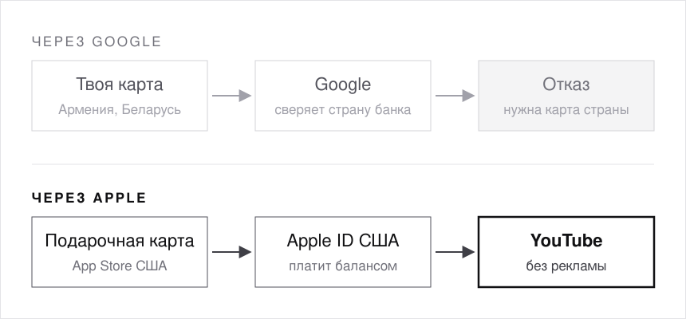

# 001 · YouTube без рекламы из Армении

YouTube Premium в Армении не продают. Платить через Google картой другой страны тоже мимо: Google проверяет страну банка. Я сделал через Apple: Apple ID США, подарочная карта и минута VPN. Работает, проверено 13 октября 2026.

<p align="center"></p>

| | |
|---|---|
| **Время** | один вечер с граблями, без граблей минут 20 |
| **Старт** | $22.60: карта на $20 и комиссия Bitrefill |
| **Карта США** | не нужна |
| **VPN** | только на минуту покупки |
| **Нужно** | iPhone |

## Почему не через Google

- Google требует карту банка той страны, где оформлена подписка ([YouTube Help](https://support.google.com/youtube/answer/10243158?hl=en&co=GENIE.CountryCode%3DKZ)). Адрес можно вписать любой, страну банка нельзя.
- Криптокарта не спасает. Страну у неё задаёт эмитент (Сингапур, Гонконг, Вьетнам), выбрать её нельзя. RedotPay вообще не пускает граждан Беларуси ([RedotPay](https://helpcenter.redotpay.com/en/articles/10339263-redotpay-unsupported-countries-regions)).
- Через Apple подписку оплачивает баланс Apple ID, и твою карту Google вообще не видит.

## Рецепт

### A. Купи подарочную карту App Store США

[Bitrefill: Apple USA](https://www.bitrefill.com/us/en/gift-cards/itunes-usa/), номиналы от $20. Платить можно криптой, картой или Apple Pay.

> **Грабли.** На странице заказа две строки. `GIFT CARD CODE: WPS-…` это внутренний номер Bitrefill, Apple его не примет. Код Apple лежит в поле **PIN**: 16 символов, начинается с `X`.

### B. Заведи второй Apple ID только для покупок

iPhone → Настройки → твоё имя → Контент и покупки → Выйти. Выходишь только из магазина: iCloud, фото и контакты остаются на основном аккаунте.

Потом App Store → иконка аккаунта → Создать Apple ID. Страна **United States**, почта любая, на которую ещё нет Apple ID, телефон свой.

> **Грабли.** SMS с кодом до армянского номера может не дойти. Жми «Did not get a code?» и выбирай звонок.

### C. Оплата None, адрес в штате без налога

Способ оплаты **None**. Адрес любой в Орегоне или Делавэре: там нет налога с продаж, и к цене ничего не прибавится. Если варианта None нет, введи на этом же экране код подарочной карты.

### D. Погаси код

App Store → иконка аккаунта → Погасить подарочную карту или код → вставь PIN. Баланс появится под именем.

### E. Включи VPN США на iPhone

Без VPN YouTube пишет `YouTube Premium is not available in your country`. Хватает бесплатного [Windscribe](https://windscribe.com/download): United States → Connect.

> **Грабли.** VPN в браузере на компе не поможет: баланс Apple работает только в приложении YouTube на iPhone.

### F. Купи подписку в приложении YouTube

Закрой YouTube и открой заново. Аватар → Получить YouTube Premium → выбери тариф → оплата с баланса. Потом VPN можно выключать, у меня всё работает без него.

## Lite или Premium

| Где реклама | Lite | Premium |
|---|---|---|
| Обычные видео | нет | нет |
| Главная и поиск | есть | нет |
| Shorts | есть | нет |
| Музыкальные клипы | есть | нет |

Lite влез в баланс $20. Premium через Apple стоит около $21 в месяц ([SlashGear](https://www.slashgear.com/2206600/why-youtube-premium-costs-more-through-apple-app-store-tax/)), так что нужна вторая карта.

## Чтобы не слетело

- Продление списывается с баланса Apple ID. До даты продления докинь ещё одну карту.
- Дата продления лежит в [подписках Apple](https://apps.apple.com/account/subscriptions).

## Риски, честно

Apple и YouTube хотят, чтобы аккаунт был из страны, где ты живёшь, а VPN YouTube прямо называет поводом для отмены ([YouTube Help](https://support.google.com/youtube/answer/6307365?hl=ru)). Худшее, что я нашёл в реальных историях: подписку не продлевают, деньги за текущий месяц не возвращают. Баланс остаётся на Apple ID, аккаунты не блокируют.

## Что я проверил и отбросил

| Способ | Почему нет |
|---|---|
| Криптокарта | страна банка не та, выбрать нельзя |
| Виртуальная карта «с выбором BIN» | Google не принимает виртуальные карты, продавцы серые |
| Коды Google Play чужой страны | погасить можно, только находясь в этой стране |
| Слот в чужом семейном тарифе | YouTube раз в 30 дней сверяет, где ты живёшь |
| Карта Kaspi (Казахстан) | рабочий вариант, но нужна поездка в Алматы |

## Пусть ИИ проведёт тебя

Скопируй в Claude или ChatGPT:

```
Прочитай https://raw.githubusercontent.com/JerrySahon/vibe-fixes/main/001-youtube-premium-armenia/AGENT.md и проведи меня по шагам
```

Если твой ИИ не открывает ссылки, просто перетащи [AGENT.md](AGENT.md) в чат.

---

Сэкономил вечер? Поставь ⭐ [репо](https://github.com/JerrySahon/vibe-fixes). Jerry · Ереван · октябрь 2026
